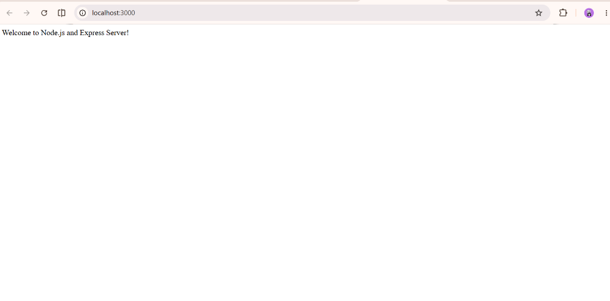
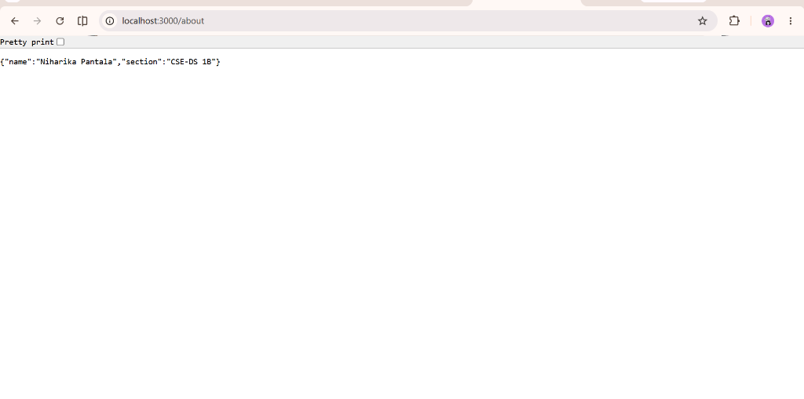
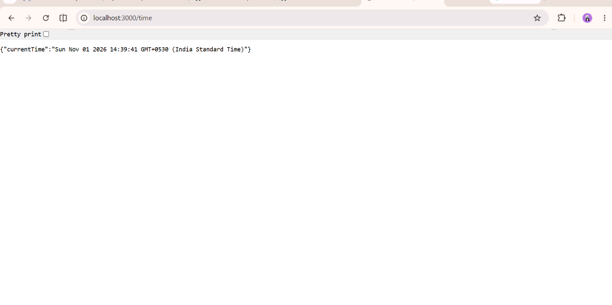
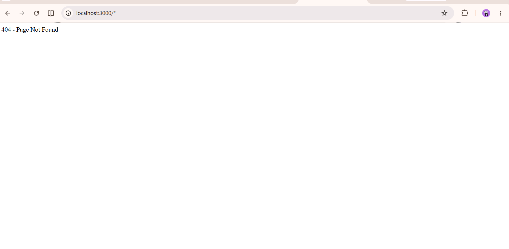

# Lab 1: Node.js and Express Server

> **Backend Development Fundamentals**  
> Department of Computer Science & Engineering (Data Science)

---

## 🌐 Live Deployment & Repository Links

- **Live Render Web Service:** [Deploying to Render via GitHub...]  
  *(Will be populated with the exact active Render URL once deployed, e.g., `https://lab-01-xxxx.onrender.com`)*
- **GitHub Repository:** [Awaiting repository URL...]

---

## 👤 Student Profile

| Field | Details |
| :--- | :--- |
| **Student Name** |  Pantala Niharika|
| **Registration Number** | 252U1R3070 |
| **Section** | CSE-DS 1B |
| **Lab** | Lab 1 – Node.js and Express Server |
| **Course** | Backend Development Fundamentals |

---

## 🎯 Objectives

1. Understand the core principles of Node.js event-driven, asynchronous I/O runtime.
2. Build a low-level web server using Node's native `http` module and `http.createServer()`.
3. Construct a production-ready web application using the Express.js framework.
4. Implement RESTful HTTP routing, structured JSON serialization, and dynamic request processing.
5. Create request lifecycle logging middleware and robust 404 Not Found error handling.
6. Configure cloud-compliant networking (dynamic `process.env.PORT` binding and `0.0.0.0` host interface).
7. Version-control the project with Git/GitHub and deploy live on Render.

---

## 🛠️ Technologies Used

- **Runtime:** Node.js (v18+)
- **Framework:** Express.js (v5.x)
- **Core Modules:** `http`, `events`
- **Version Control:** Git & GitHub
- **Hosting & Deployment:** Render (Web Service)

---

## 📁 Project Directory Structure

```text
lab-01/
├── basic-server.js        # Core Node.js HTTP server using http.createServer()
├── server.js              # Express.js application with routing & middleware
├── package.json           # Project metadata, dependencies & npm scripts
├── package-lock.json      # Locked dependency tree
├── .gitignore             # Git exclusions (node_modules, .env, OS files)
├── README.md              # Comprehensive lab report & documentation
└── screenshots/           # Verification screenshots of working endpoints
    ├── 01-home.png        # Screenshot of GET / (Home page)
    ├── 02-about.png       # Screenshot of GET /about (JSON)
    ├── 03-time.png        # Screenshot of GET /time (JSON)
    ├── 04-404.png         # Screenshot of unknown route (404 Not Found)
    └── 05-terminal.png    # Screenshot of server terminal logs
```

---

## 🚀 Installation & Execution

### Prerequisites
- [Node.js](https://nodejs.org/) (version 18.0.0 or higher)
- [Git](https://git-scm.com/)
- npm (bundled with Node.js)

### 1. Clone the Repository
```bash
git clone <YOUR_GITHUB_REPOSITORY_URL>
cd lab-01
```

### 2. Install Dependencies
```bash
npm install
```

### 3. Run the Servers

#### Express.js Server (Main Application)
```bash
# Production start (configured in package.json)
npm start

# Development mode with live reload
npm run dev
```
The Express server will start on `http://localhost:3000`.

#### Basic Native HTTP Server
```bash
# Run the low-level Node.js http.createServer demonstration
npm run start:basic
```
The native HTTP server will start on `http://localhost:3000`.

---

## 📡 API Endpoint Documentation

| Method | Endpoint | Description | Content-Type | Status Code | Sample Response |
| :---: | :--- | :--- | :---: | :---: | :--- |
| `GET` | `/` | Displays welcome message | `text/html` | `200 OK` | `Welcome to Node.js and Express Server!` |
| `GET` | `/about` | Returns student name & section | `application/json` | `200 OK` | `{"name":"Niharika Pantala","section":"CSE-DS 1B"}` |
| `GET` | `/time` | Current date & time using `new Date()` | `application/json` | `200 OK` | `{"currentTime":"Sun Nov 01 2026..."}` |
| `ANY` | `/*` (Unknown) | Catch-all 404 handler for invalid routes | `text/html` / `text/plain` | `404 Not Found` | `404 - Page Not Found` |

---

## 📸 Endpoint Verification Screenshots

> Screenshots captured from actual running instances of the server.

### 1. Home Page (`GET /`)
- **Status:** `200 OK`
- **Output:** `Welcome to Node.js and Express Server!`


### 2. About Endpoint (`GET /about`)
- **Status:** `200 OK`
- **Output:** JSON object containing `name: "Niharika Pantala"` and `section: "CSE-DS 1B"`.


### 3. Time Endpoint (`GET /time`)
- **Status:** `200 OK`
- **Output:** JSON object containing dynamically generated date and time via `new Date()`.


### 4. 404 Error Handler (`GET /unknown-route`)
- **Status:** `404 Not Found`
- **Output:** `404 - Page Not Found`

- **Output:** Friendly error page / structured JSON returning `404 - Page Not Found`.


### 5. Terminal Execution & Logger Logs
- **Output:** Server startup confirmation and real-time request lifecycle log.


---

## 💡 Problems Faced and Solutions

1. **Port Conflicts & Dynamic Cloud Port Assignment (`process.env.PORT`)**:
   - *Problem:* Running applications with hardcoded ports like `3000` causes crashes in cloud hosting environments (such as Render) where ports are dynamically assigned by the host container.
   - *Solution:* Implemented dynamic port resolution `const PORT = process.env.PORT || 3000;` and bound the listener to `HOST = '0.0.0.0'` so that the service binds to all external network interfaces in a containerized environment.

2. **Stream Management in Native `http.createServer`**:
   - *Problem:* When developing `basic-server.js`, missing `res.end()` resulted in browser requests hanging indefinitely because Node's native HTTP streams require explicit termination.
   - *Solution:* Ensured every routing branch in `basic-server.js` terminates with `res.end()` after setting the proper headers with `res.writeHead()`. In Express (`server.js`), this is abstracted and handled automatically by `res.send()` and `res.json()`.

3. **Middleware Ordering for the 404 Handler**:
   - *Problem:* Placing the 404 catch-all middleware prior to route declarations caused all incoming requests to be short-circuited as 404 errors.
   - *Solution:* Express executes middleware sequentially in the order registered. Positioned the 404 catch-all handler as the final handler after all valid route definitions (`/`, `/about`, `/time`).

4. **Content Negotiation for Browser vs API Consumers**:
   - *Problem:* The lab requires a clean HTML response for the browser on the home page and 404 errors, but REST API clients (like curl or automated test suites) often expect JSON or plain text.
   - *Solution:* Used Express's `res.format()` to dynamically deliver rich responsive HTML to web browsers and clean JSON to API clients requesting `application/json`.

---

## 🏁 Conclusion

In this laboratory assignment, I successfully implemented both a native Node.js HTTP server (`basic-server.js`) and a scalable Express.js web server (`server.js`). Key learnings include understanding the HTTP request-response cycle, the role of middleware in Express, proper status code semantics (200 OK vs 404 Not Found), and configuring web servers for containerized cloud deployment on platforms like Render.
