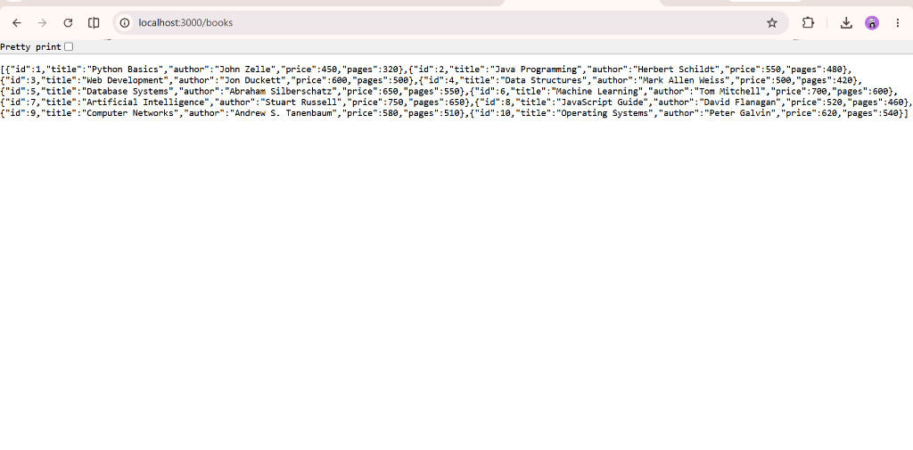
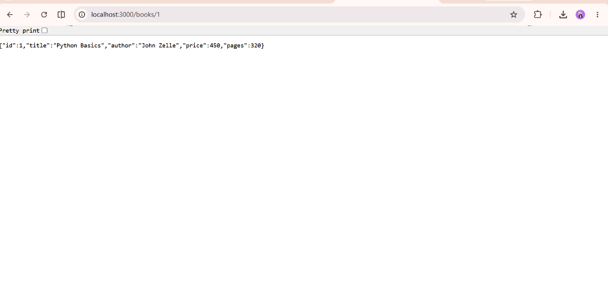
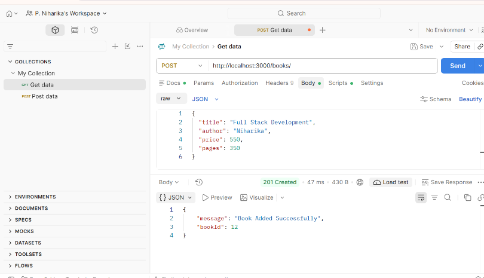
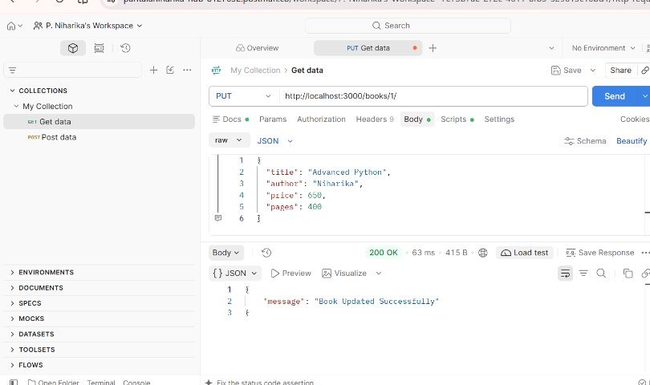
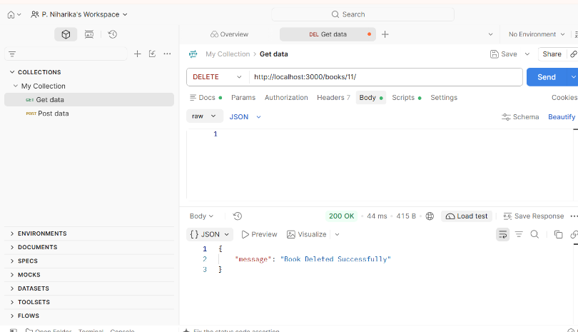
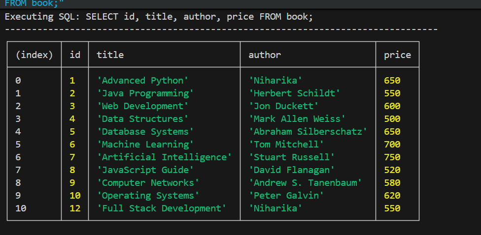
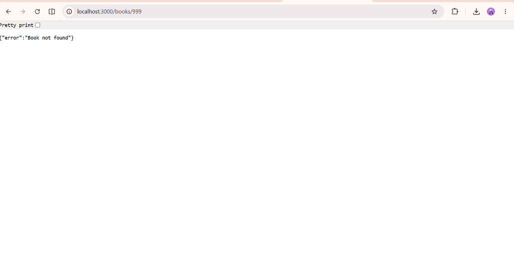

# Lab 02: SQLite and Relational Database Operations

> **Backend Development Fundamentals**  
> Department of Computer Science & Engineering (Data Science)  
> **Aurora University**

---

## 👤 Student Details

| Field | Details |
| :--- | :--- |
| **Student Name** | Niharika Pantala |
| **Registration Number** | [Your Registration Number Here] |
| **Section** | CSE-DS 1B |
| **Subject** | Backend Development Fundamentals |
| **Lab** | 02 – SQLite and Relational Database Operations |
| **Faculty** | Joel Prashanth D. |
| **University** | Aurora University |

---

## 🔗 Project Links

- **GitHub Repository Link:** [https://github.com/pantalaniharika-hub/Backend-Development-Fundamentals](https://github.com/pantalaniharika-hub/Backend-Development-Fundamentals)
- **Live Deployment Link:** [https://niharika-lab-2-sqlite.onrender.com/books/](https://niharika-lab-2-sqlite.onrender.com/books/)

---

## 🎯 1. Objective

The primary objectives of this laboratory are:
1. To understand embedded relational database fundamentals using **SQLite** (`book.db`).
2. To integrate SQLite with an **Express.js** application using the promise-based `sqlite` wrapper and the official `sqlite3` driver.
3. To design and implement an asynchronous initialization architecture via `initializeDBAndServer()` to ensure the database connection and schema exist before the HTTP server starts listening.
4. To build a complete set of RESTful **CRUD** (Create, Read, Update, Delete) APIs for managing book resources.
5. To enforce database security and prevent **SQL Injection** attacks by using parameterized queries with `?` placeholders.
6. To implement robust client payload validation, comprehensive error handling, and standard HTTP response status codes (`200 OK`, `201 Created`, `400 Bad Request`, `404 Not Found`, and `500 Internal Server Error`).
7. To systematically test and verify each endpoint using Postman and inspect database persistence using SQLite queries.

---

## 🛠️ 2. Technologies Used

- **Runtime Environment:** Node.js (v18+)
- **Web Framework:** Express.js (`express`)
- **Database Engine:** SQLite 3 (`book.db`)
- **Database Drivers & Libraries:**
  - `sqlite3` – Core SQLite database driver for Node.js
  - `sqlite` – Modern Promise/async-await wrapper for `sqlite3`
- **Development Utility:** `nodemon` (automatic server reload on file changes)
- **API Testing Client:** Postman
- **Version Control:** Git & GitHub

---

## 📁 3. Project Folder Structure

The repository structure preserves Lab 1 while keeping Lab 2 completely self-contained and independently runnable:

```text
backend-development/
├── lab-01/                                      # Lab 1 Project (Preserved)
│   ├── ...
│   └── README.md
│
└── lab-02/                                      # Lab 2 Project (Independent)
    ├── node_modules/                            # Node.js dependencies (ignored by Git)
    ├── screenshots/                             # Postman & Database verification screenshots
    │   ├── get-all-books.png
    │   ├── get-single-book.png
    │   ├── post-book.png
    │   ├── put-book.png
    │   ├── delete-book.png
    │   ├── sqlite-database.png
    │   └── not-found.png
    ├── .gitignore                               # Specifies intentionally untracked files
    ├── book.db                                  # SQLite database file containing the book table
    ├── cli.js                                   # CLI script for inspecting SQLite data
    ├── Lab2_Books_API.postman_collection.json   # Exported Postman collection for testing
    ├── package.json                             # Dependencies and npm script definitions
    ├── package-lock.json                        # Locked dependency versions
    ├── README.md                                # Comprehensive laboratory documentation
    └── server.js                                # Express application & CRUD route implementations
```

---

## 🗄️ 4. Database Schema

The database `book.db` consists of a single relational table named `book` defined as follows:

```sql
CREATE TABLE IF NOT EXISTS book (
  id INTEGER PRIMARY KEY AUTOINCREMENT,
  title TEXT NOT NULL,
  author TEXT NOT NULL,
  price INTEGER NOT NULL,
  pages INTEGER NOT NULL
);
```

### Column Specifications

| Column Name | Data Type | Constraints | Description |
| :--- | :--- | :--- | :--- |
| `id` | `INTEGER` | `PRIMARY KEY AUTOINCREMENT` | Unique identifier for each book record |
| `title` | `TEXT` | `NOT NULL` | Title of the book |
| `author` | `TEXT` | `NOT NULL` | Author of the book |
| `price` | `INTEGER` | `NOT NULL` | Price of the book in INR |
| `pages` | `INTEGER` | `NOT NULL` | Number of pages in the book |

### Initial Seed Data (10 Sample Records)

The server automatically populates 10 realistic sample book records upon initial startup if the table is empty:

| ID | Title | Author | Price (₹) | Pages |
|:--:|:---|:---|:--:|:--:|
| 1 | Python Basics | John Zelle | 450 | 320 |
| 2 | Java Programming | Herbert Schildt | 550 | 480 |
| 3 | Web Development | Jon Duckett | 600 | 500 |
| 4 | Data Structures | Mark Allen Weiss | 500 | 420 |
| 5 | Database Systems | Abraham Silberschatz | 650 | 550 |
| 6 | Machine Learning | Tom Mitchell | 700 | 600 |
| 7 | Artificial Intelligence | Stuart Russell | 750 | 650 |
| 8 | JavaScript Guide | David Flanagan | 520 | 460 |
| 9 | Computer Networks | Andrew S. Tanenbaum | 580 | 510 |
| 10 | Operating Systems | Peter Galvin | 620 | 540 |

---

## 📥 5. Installation Instructions

Follow these steps to set up the project locally:

1. **Clone the existing repository** (or navigate to your local working copy):
   ```bash
   git clone https://github.com/[Your-Username]/[Your-Repository].git
   cd backend-development
   ```

2. **Navigate into the `lab-02` directory**:
   ```bash
   cd lab-02
   ```

3. **Install the required npm dependencies**:
   ```bash
   npm install
   ```

---

## ▶️ 6. How to Run the Project

Inside the `lab-02` folder, you can run the application in two modes:

### Standard Production Mode
```bash
npm start
```
*Executes `node server.js` and listens on `http://localhost:3000`.*

### Development Mode (with Live Reloading)
```bash
npm run dev
```
*Executes `nodemon server.js` which automatically detects code changes and restarts the server.*

---

## 📡 7. API Endpoint Table

| Endpoint # | HTTP Method | Route URL | Purpose / Operation | Success Status | Error Status |
|:---:|:---:|:---|:---|:---:|:---:|
| **1** | `GET` | `/books/` | Retrieve all books from the database | `200 OK` | `500 Internal Server Error` |
| **2** | `GET` | `/books/:bookId/` | Retrieve a specific book by its ID | `200 OK` | `404 Not Found`, `500 Internal Server Error` |
| **3** | `POST` | `/books/` | Insert a new book record into the database | `201 Created` | `400 Bad Request`, `500 Internal Server Error` |
| **4** | `PUT` | `/books/:bookId/` | Update all attributes of an existing book | `200 OK` | `400 Bad Request`, `404 Not Found`, `500` |
| **5** | `DELETE` | `/books/:bookId/` | Delete an existing book by its ID | `200 OK` | `404 Not Found`, `500 Internal Server Error` |
| **-** | `ALL` | `*` *(Any Unknown Route)* | Catch-all handler for undefined paths | *N/A* | `404 Not Found` |

---

## 📝 8. Sample Request and Response Details

### 1. GET All Books
- **URL:** `http://localhost:3000/books/`
- **Method:** `GET`
- **Headers:** None required
- **Status:** `200 OK`
- **Sample Response:**
```json
[
  {
    "id": 1,
    "title": "Python Basics",
    "author": "John Zelle",
    "price": 450,
    "pages": 320
  },
  {
    "id": 2,
    "title": "Java Programming",
    "author": "Herbert Schildt",
    "price": 550,
    "pages": 480
  },
  "... (10 total records) ..."
]
```

---

### 2. GET Specific Book by ID
- **URL:** `http://localhost:3000/books/1/`
- **Method:** `GET`
- **Headers:** None required
- **Status:** `200 OK`
- **Sample Response:**
```json
{
  "id": 1,
  "title": "Python Basics",
  "author": "John Zelle",
  "price": 450,
  "pages": 320
}
```

- **Non-existent ID Request:** `http://localhost:3000/books/999/`
- **Status:** `404 Not Found`
- **Sample Response:**
```json
{
  "error": "Book not found"
}
```

---

### 3. POST Add a New Book
- **URL:** `http://localhost:3000/books/`
- **Method:** `POST`
- **Headers:** `Content-Type: application/json`
- **Request Body:**
```json
{
  "title": "Full Stack Development",
  "author": "Niharika",
  "price": 550,
  "pages": 350
}
```
- **Status:** `201 Created`
- **Sample Response:**
```json
{
  "message": "Book Added Successfully",
  "bookId": 11
}
```

- **Validation Error (Missing Fields):**
```json
{
  "title": "Incomplete Book"
}
```
- **Status:** `400 Bad Request`
- **Sample Response:**
```json
{
  "error": "Invalid input. 'title', 'author', 'price', and 'pages' are required."
}
```

---

### 4. PUT Update an Existing Book
- **URL:** `http://localhost:3000/books/1/`
- **Method:** `PUT`
- **Headers:** `Content-Type: application/json`
- **Request Body:**
```json
{
  "title": "Advanced Python",
  "author": "Niharika",
  "price": 650,
  "pages": 400
}
```
- **Status:** `200 OK`
- **Sample Response:**
```json
{
  "message": "Book Updated Successfully"
}
```

- **Update Non-existent ID Request:** `http://localhost:3000/books/999/`
- **Status:** `404 Not Found`
- **Sample Response:**
```json
{
  "error": "Book not found"
}
```

---

### 5. DELETE a Book
- **URL:** `http://localhost:3000/books/11/`
- **Method:** `DELETE`
- **Headers:** None required
- **Status:** `200 OK`
- **Sample Response:**
```json
{
  "message": "Book Deleted Successfully"
}
```

- **Delete Non-existent ID Request:** `http://localhost:3000/books/999/`
- **Status:** `404 Not Found`
- **Sample Response:**
```json
{
  "error": "Book not found"
}
```

---

### 6. Unknown Route (Catch-all 404)
- **URL:** `http://localhost:3000/api/unknown-endpoint`
- **Method:** `GET`
- **Status:** `404 Not Found`
- **Sample Response:**
```json
{
  "error": "404 - Endpoint Not Found"
}
```

---

## 🔒 9. Security Implementation: Parameterized Queries

To safeguard the application from **SQL Injection (SQLi)** vulnerabilities, all SQL operations that incorporate user inputs strictly employ parameterized placeholders (`?`). Values are passed in parameter arrays so the database engine separates SQL commands from untrusted client data:

```javascript
// Parameterized SQL Query (Secure against SQL Injection)
const updateBookQuery = `
  UPDATE book
  SET title = ?, author = ?, price = ?, pages = ?
  WHERE id = ?;
`;
await db.run(updateBookQuery, [title, author, price, pages, bookId]);
```

Direct string concatenation (e.g. ``WHERE id = ${bookId}``) was avoided throughout the implementation.

---

## 📸 10. Screenshots Section

> Save your test screenshots into the `screenshots/` directory using the filenames below. Once added, they will render directly in this document.

### 1. GET All Books (`GET /books/`)
*Postman screenshot displaying the retrieval of all 10 initial books with status `200 OK`.*


### 2. GET Single Book (`GET /books/1/`)
*Postman screenshot displaying retrieval of book ID 1 with status `200 OK`.*


### 3. POST Add New Book (`POST /books/`)
*Postman screenshot showing the creation of "Full Stack Development" with status `201 Created` and generated `bookId: 11`.*


### 4. PUT Update Book (`PUT /books/1/`)
*Postman screenshot showing the update of book ID 1 to "Advanced Python" with status `200 OK`.*


### 5. DELETE Book (`DELETE /books/11/`)
*Postman screenshot showing deletion of book ID 11 with status `200 OK`.*


### 6. SQLite Database Verification
*Screenshot from SQLite CLI (`node cli.js "SELECT * FROM book;"`) or DB Browser for SQLite showing the records persisted on disk.*


### 7. 404 Route / Resource Not Found
*Postman screenshot showing a `404 Not Found` response when querying a non-existent book ID (e.g., `GET /books/999/`) or unknown route.*


---

## 💻 11. SQLite CLI Verification Script

To directly inspect and query the SQLite database without third-party GUI tools, use the bundled `cli.js` script:

```bash
# Display all records in table format
node cli.js "SELECT * FROM book;"

# Query a specific record by ID
node cli.js "SELECT * FROM book WHERE id = 1;"

# Query the auto-increment sequence state
node cli.js "SELECT * FROM sqlite_sequence WHERE name = 'book';"
```

---

## 🎓 12. Learning Outcomes

Through completing this lab assignment, I have learned:
1. How to configure and interact with an embedded SQLite relational database in Node.js using `sqlite3` and `sqlite`.
2. The necessity of asynchronous synchronization (`async/await`) in coordinating database readiness before opening network sockets (`initializeDBAndServer()`).
3. How to design and structure complete RESTful CRUD endpoints following standard HTTP methods (`GET`, `POST`, `PUT`, `DELETE`).
4. The critical importance of defensive programming against SQL Injection using parameterized queries (`?`).
5. Proper validation of client input payloads and returning semantically accurate HTTP status codes (`200`, `201`, `400`, `404`, `500`).
6. How to utilize Postman to build repeatable automated API test collections.

---

## 🏁 13. Conclusion

Lab 2 successfully demonstrates the end-to-end integration of a Node.js Express server with an SQLite relational database. All five CRUD API endpoints have been implemented, secured with parameterized queries, validated with descriptive status codes, and tested for database persistence. The project resides independently within the existing `backend-development` Git repository alongside Lab 1.
