# Lab 3: REST API, Query Parameters, Validation, and Debugging

> **Backend Development Fundamentals**  
> Department of Computer Science & Engineering (Data Science)  
> **Aurora University**

---

## 🌐 Live Deployment URL

- **Production API URL (Render):** [https://niharika-lab-3-api.onrender.com/books/](https://niharika-lab-3-api.onrender.com/books/)  
  *(Placeholder: Replace with your actual live Render deployment URL once deployed.)*
- **Local Development URL:** `http://localhost:3000/books/`
- **GitHub Repository:** [https://github.com/pantalaniharika-hub/Backend-Development-Fundamentals](https://github.com/pantalaniharika-hub/Backend-Development-Fundamentals)

---

## 👤 Student Details

| Field | Details |
| :--- | :--- |
| **Student Name** | Niharika Pantala |
| **Registration Number** | 252U1R3070 |
| **Section** | CSE-DS (2B) |
| **University** | Aurora University |
| **Subject** | Backend Development Fundamentals |
| **Lab Number** | 03 |
| **Lab Title** | REST API, Query Parameters, Validation, and Debugging |
| **Faculty** | Mr. Yugandhar |

---

## 🎯 1. Objective

The primary objectives of this laboratory are:
1. To design and implement a production-grade RESTful API using **Node.js**, **Express.js**, and an embedded **SQLite** relational database (`book.db`).
2. To master query parameters for server-side filtering, partial-text searching (`SQL LIKE`), column sorting (`order_by`), order directions (`ASC` / `DESC`), and pagination (`limit` and `offset`).
3. To implement flexible numerical range filtering using `min_price` and `max_price` SQL conditions (`BETWEEN`).
4. To enforce bulletproof backend validation for request bodies, query strings, and URL path parameters, rejecting invalid inputs with standard HTTP status codes (`400 Bad Request`, `404 Not Found`) and descriptive JSON messages before they reach the database layer.
5. To prevent SQL Injection vulnerabilities using strict allowlists for identifiers and parameterized queries (`?` placeholders) for all user-supplied data values.
6. To establish a standardized, predictable JSON response contract across all success and error scenarios.
7. To systematically troubleshoot and document four standard backend errors (`EADDRINUSE`, wrong module import paths, `SQLITE_ERROR: no such table`, and missing asynchronous `await` calls).
8. To build and execute an automated 22-test Postman collection validating all functional and error-handling requirements.

---

## 🛠️ 2. Technologies Used

- **Runtime Environment:** Node.js (v18+)
- **Web Application Framework:** Express.js (`express` v4.19.2)
- **Database Engine:** SQLite 3 (`book.db`)
- **Database Drivers & Wrappers:**
  - `sqlite3` (v5.1.7) – Core C/C++ SQLite bindings for Node.js
  - `sqlite` (v5.1.1) – Promise-based wrapper enabling `async`/`await` database access
- **Development & Live-Reload Tool:** `nodemon` (v3.1.0)
- **API Testing & Verification:** Postman & Built-in In-Process Test Suite (`verify-all.js`)
- **Version Control:** Git & GitHub
- **Cloud Deployment:** Render Cloud Platform

---

## 📁 3. Project Folder Structure

The project resides inside the unified `backend-development` repository while remaining completely self-contained and independently runnable:

```text
backend-development/
│
├── lab-01/                                      # Lab 1 Project (Preserved)
│
├── lab-02/                                      # Lab 2 Project (Preserved)
│
└── lab-03/                                      # Lab 3 Project (Current)
    ├── .gitignore                               # Ignores node_modules/ and .env
    ├── book.db                                  # SQLite Database File with Book Table
    ├── cli.js                                   # Command-line utility to query book.db directly
    ├── debugging-notes.md                       # Comprehensive guide to 4 backend errors
    ├── init-db.js                               # Database initialization and seeding script
    ├── package.json                             # Dependencies, metadata, and scripts
    ├── package-lock.json                        # Exact pinned dependency tree
    ├── postman_collection.json                  # Complete 22-test Postman collection
    ├── README.md                                # Comprehensive project documentation
    ├── server.js                                # Main Express server and REST API routes
    ├── verify-all.js                            # Automated in-memory verification runner
    └── screenshots/                             # Postman & Database verification images
        ├── .gitkeep
        ├── get-all-books.png
        ├── search-books.png
        ├── sort-books.png
        ├── pagination.png
        ├── price-filter.png
        ├── post-book.png
        ├── put-book.png
        ├── delete-book.png
        ├── validation-error.png
        ├── not-found.png
        └── debugging.png
```

---

## 🗄️ 4. SQLite Database Schema

The application connects to a standalone SQLite database file named `book.db`. The table definition and column constraints are defined as follows:

```sql
CREATE TABLE book (
    id INTEGER PRIMARY KEY AUTOINCREMENT,
    title TEXT,
    author TEXT,
    price INTEGER,
    pages INTEGER
);
```

### Initial Seed Records (12 Realistic Books)

| ID | Title | Author | Price (₹) | Pages |
| :---: | :--- | :--- | :---: | :---: |
| 1 | Clean Code | Robert C. Martin | 650 | 464 |
| 2 | The Pragmatic Programmer | Andrew Hunt & David Thomas | 720 | 352 |
| 3 | Introduction to Algorithms | Thomas H. Cormen | 950 | 1312 |
| 4 | JavaScript: The Good Parts | Douglas Crockford | 380 | 176 |
| 5 | You Don't Know JS: Scope & Closures | Kyle Simpson | 420 | 98 |
| 6 | Python Crash Course | Eric Matthes | 540 | 544 |
| 7 | Fluent Python | Luciano Ramalho | 800 | 792 |
| 8 | Designing Data-Intensive Applications | Martin Kleppmann | 890 | 616 |
| 9 | Design Patterns: Elements of Reusable Object-Oriented Software | Erich Gamma et al. | 750 | 395 |
| 10 | Node.js Design Patterns | Mario Casciaro | 620 | 520 |
| 11 | Learning SQL | Alan Beaulieu | 450 | 380 |
| 12 | Effective Java | Joshua Bloch | 680 | 412 |

---

## 📦 5. Installation Commands

Navigate into the `lab-03` directory and install all required runtime and development dependencies:

```bash
# 1. Navigate to Lab 3 folder
cd lab-03

# 2. Install dependencies
npm install
```

---

## ▶️ 6. Run Commands

| Command | Action | Description |
| :--- | :--- | :--- |
| `npm start` | Starts production server | Runs `node server.js` |
| `npm run dev` | Starts development server | Runs `nodemon server.js` with live reloading |
| `npm run init-db` | Initializes / resets database | Runs `node init-db.js` and seeds initial 12 books |
| `npm test` | Automated verification | Runs `node verify-all.js` checking all 22 test cases |
| `node cli.js "<SQL>"` | Direct database query | Executes SQL queries directly on `book.db` |

---

## ⚙️ 7. Required Environment Variables

The server dynamically detects environment settings with safe local fallbacks:

| Variable | Required | Default Value | Description |
| :--- | :---: | :---: | :--- |
| `PORT` | Optional | `3000` | The network port Express binds to (automatically assigned by Render in production) |

---

## 🛣️ 8. API Endpoints Table

| Method | Endpoint | Description | Expected Status |
| :--- | :--- | :--- | :---: |
| `GET` | `/books/` | Retrieve all books with optional search, sorting, pagination, and price range | `200 OK` / `400 Bad Request` |
| `GET` | `/books/:bookId/` | Retrieve a single book record by primary key `id` | `200 OK` / `400 Bad Request` / `404 Not Found` |
| `POST` | `/books/` | Add a new book to the database with payload validation | `201 Created` / `400 Bad Request` |
| `PUT` | `/books/:bookId/` | Update all fields of an existing book by `id` | `200 OK` / `400 Bad Request` / `404 Not Found` |
| `DELETE` | `/books/:bookId/` | Permanently remove a book record by `id` | `200 OK` / `400 Bad Request` / `404 Not Found` |
| `*` | Any undefined route | Catch-all handler for unknown endpoints | `404 Not Found` |

---

## 🔍 9. Query Parameter Descriptions and Defaults

All query parameters for `GET /books/` are optional and can be combined seamlessly:

| Parameter | Type | Default | Description & Constraints | Allowed Values / Format |
| :--- | :---: | :---: | :--- | :--- |
| `search_q` | String | None | Case-insensitive partial title matching using SQL `LIKE %search_q%` | Any string (e.g., `Python`) |
| `order_by` | String | `id` | Database column used to sort the returned dataset | `id`, `title`, `author`, `price`, `pages` |
| `order` | String | `ASC` | Direction of the sort operation (case-insensitive) | `ASC`, `DESC` |
| `limit` | Integer | `10` | Maximum number of book records to return per page | Positive integer (`limit > 0`) |
| `offset` | Integer | `0` | Number of records to skip for pagination | Non-negative integer (`offset >= 0`) |
| `min_price` | Number | None | Minimum book price filter (`price >= min_price`) | Non-negative number (`>= 0`) |
| `max_price` | Number | None | Maximum book price filter (`price <= max_price`) | Non-negative number (`>= 0`) |

---

## 💡 10. Query Filter Examples

### A. Partial Title Search
```http
GET /books/?search_q=Python
```
*Matches "Python Crash Course" and "Fluent Python".*

### B. Ascending and Descending Sorting
```http
GET /books/?order_by=price&order=ASC
GET /books/?order_by=pages&order=DESC
```

### C. Offset Pagination
```http
GET /books/?limit=5&offset=0
GET /books/?limit=5&offset=5
```

### D. Price Range Filtering
```http
GET /books/?min_price=400&max_price=700
```
*Returns books whose price is between ₹400 and ₹700 (inclusive).*

### E. Combined Multi-Parameter Query
```http
GET /books/?search_q=Python&order_by=price&order=DESC&limit=5&offset=0&min_price=200&max_price=700
```

---

## 📄 11. Sample Request and Response Formats

### 1. GET `/books/` (Retrieve Books)
**Request:**
```http
GET /books/?search_q=Python&order_by=price&order=DESC HTTP/1.1
Host: localhost:3000
```

**Response (200 OK):**
```json
{
  "message": "Books retrieved successfully",
  "data": [
    {
      "id": 7,
      "title": "Fluent Python",
      "author": "Luciano Ramalho",
      "price": 800,
      "pages": 792
    },
    {
      "id": 6,
      "title": "Python Crash Course",
      "author": "Eric Matthes",
      "price": 540,
      "pages": 544
    }
  ]
}
```

---

### 2. GET `/books/:bookId/` (Retrieve Single Book)
**Request:**
```http
GET /books/1/ HTTP/1.1
Host: localhost:3000
```

**Response (200 OK):**
```json
{
  "message": "Book retrieved successfully",
  "data": {
    "id": 1,
    "title": "Clean Code",
    "author": "Robert C. Martin",
    "price": 650,
    "pages": 464
  }
}
```

---

### 3. POST `/books/` (Create New Book)
**Request:**
```http
POST /books/ HTTP/1.1
Host: localhost:3000
Content-Type: application/json

{
  "title": "Full Stack Development",
  "author": "Niharika",
  "price": 550,
  "pages": 350
}
```

**Response (201 Created):**
```json
{
  "message": "Book created successfully",
  "bookId": 13
}
```

---

### 4. PUT `/books/:bookId/` (Update Book)
**Request:**
```http
PUT /books/1/ HTTP/1.1
Host: localhost:3000
Content-Type: application/json

{
  "title": "Clean Code (2nd Edition)",
  "author": "Robert C. Martin",
  "price": 680,
  "pages": 480
}
```

**Response (200 OK):**
```json
{
  "message": "Book updated successfully"
}
```

---

### 5. DELETE `/books/:bookId/` (Delete Book)
**Request:**
```http
DELETE /books/13/ HTTP/1.1
Host: localhost:3000
```

**Response (200 OK):**
```json
{
  "message": "Book deleted successfully"
}
```

---

### 6. Validation Error Example
**Request:**
```http
POST /books/ HTTP/1.1
Content-Type: application/json

{
  "author": "Niharika",
  "price": 500,
  "pages": 200
}
```

**Response (400 Bad Request):**
```json
{
  "message": "Title is required"
}
```

---

### 7. Resource Not Found Example
**Request:**
```http
GET /books/99999/ HTTP/1.1
```

**Response (404 Not Found):**
```json
{
  "message": "Book not found"
}
```

---

## 🛡️ 12. Validation Rules Summary

All incoming inputs undergo strict validation before reaching SQL execution:

1. **Title Validation:** Must be present, non-empty, and a string (`400: Title is required`).
2. **Author Validation:** Must be present, non-empty, and a string (`400: Author is required`).
3. **Price Validation:**
   - Must be present (`400: Price is required`).
   - Must be a valid finite number (`400: Price must be a number`).
   - Must not be negative (`400: Price cannot be negative`).
4. **Pages Validation:** Must be an integer greater than 0 (`400: Pages must be a positive integer`).
5. **Book ID Parameter:** Must be a valid positive integer (`400: Invalid book ID`). Non-existent IDs return `404: Book not found`.
6. **Limit Parameter:** Must be a positive integer (`400: Limit must be a positive integer`).
7. **Offset Parameter:** Must be a non-negative integer (`400: Offset must be a non-negative integer`).
8. **Sorting Column (`order_by`):** Strictly restricted to `id`, `title`, `author`, `price`, `pages`. Invalid columns return `400: Invalid order_by column. Allowed columns: ...`.
9. **Sorting Direction (`order`):** Strictly restricted to `ASC` and `DESC`. Invalid values return `400: Invalid order direction. Allowed values: ASC, DESC`.
10. **Price Range Consistency:** If both `min_price` and `max_price` are provided, `min_price` cannot exceed `max_price` (`400: Minimum price cannot be greater than maximum price`).
11. **Unknown Routes:** Undefined endpoints return `404: Route not found`.

---

## 📮 13. Postman Testing Instructions

The repository provides a complete Postman collection configured with test assertions: `postman_collection.json`.

### How to Import and Run in Postman:
1. Open the **Postman** desktop application or web interface.
2. Click **Import** in the upper left corner and select `lab-03/postman_collection.json`.
3. In the collection settings, inspect the **Variables** tab:
   - Variable name: `baseUrl`
   - Initial / Current Value: `http://localhost:3000` (or your live Render URL).
4. Start your local server:
   ```bash
   cd lab-03
   npm run dev
   ```
5. Click on the collection name **"Lab 3 - REST API Testing"** and click **Run collection**.
6. Ensure all 22 test requests are selected and click **Run Lab 3 - REST API Testing**.
7. All 22 automated tests will execute and display green checkmarks (`PASS`).

---

## 📸 14. Screenshots Section

Below are the designated screenshot references documenting API execution and database verification.

### How to Capture and Save Real Screenshots:
1. Start the server using `npm run dev`.
2. Open Postman, execute each request, and use your operating system's screenshot tool (`Win + Shift + S` on Windows):
   - Capture the request URL, body, response status code, and JSON output.
3. Save each image with the exact filename below inside the `lab-03/screenshots/` folder.

| Screenshot Name | Endpoint / Action Demonstrated | Image Reference |
| :--- | :--- | :--- |
| `get-all-books.png` | GET `/books/` returning all 12 initial books | 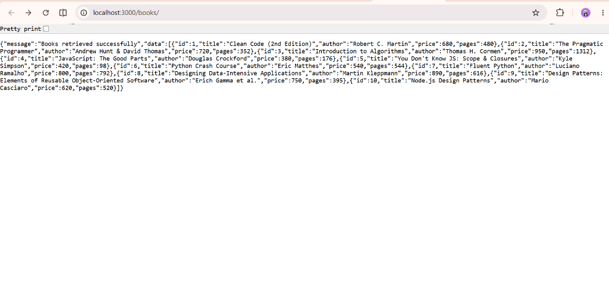 |
| `search-books.png` | GET `/books/?search_q=Python` partial title search | 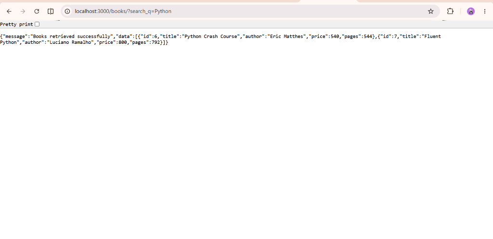 |
| `sort-books.png` | GET `/books/?order_by=price&order=ASC` sorted books | 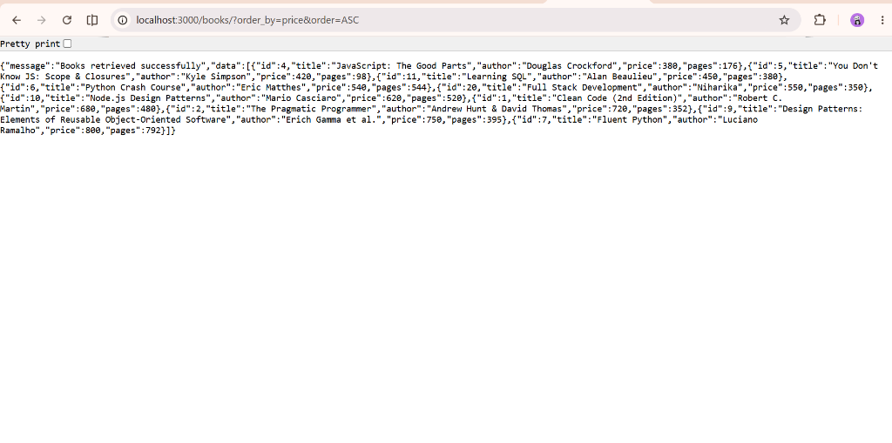 |
| `pagination.png` | GET `/books/?limit=5&offset=2` paginated records | 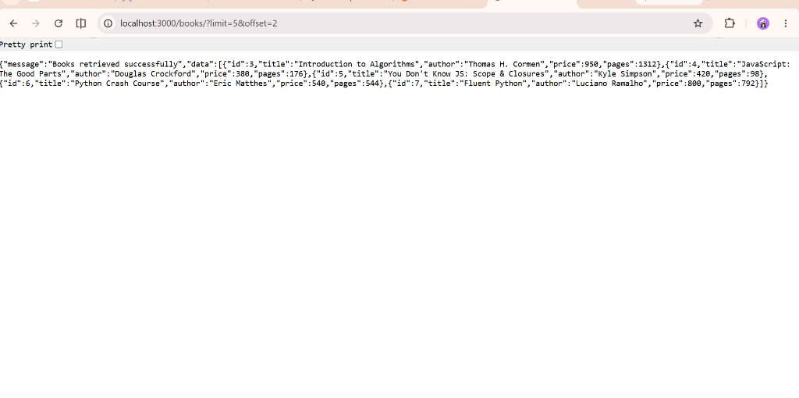 |
| `price-filter.png` | GET `/books/?min_price=200&max_price=700` price filtering | 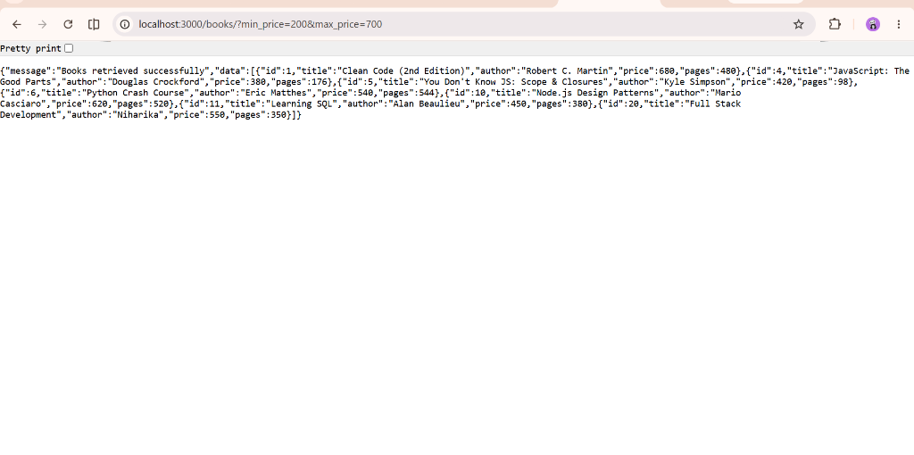 |
| `post-book.png` | POST `/books/` creating a new book (201 Created) | 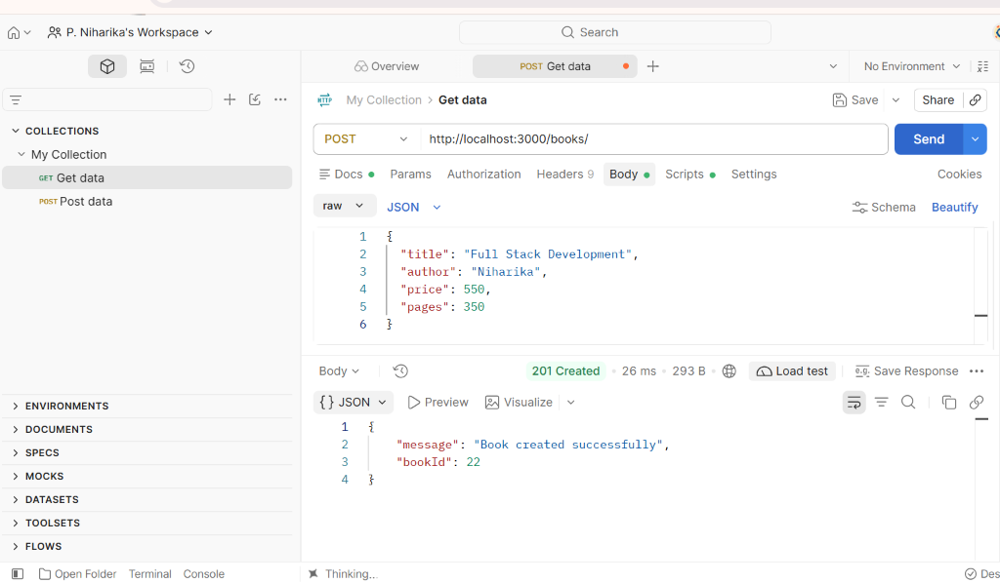 |
| `put-book.png` | PUT `/books/1/` updating an existing book (200 OK) | 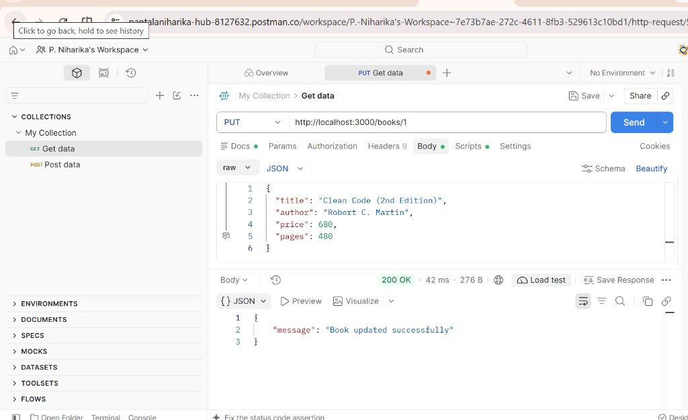 |
| `delete-book.png` | DELETE `/books/13/` deleting a book (200 OK) | 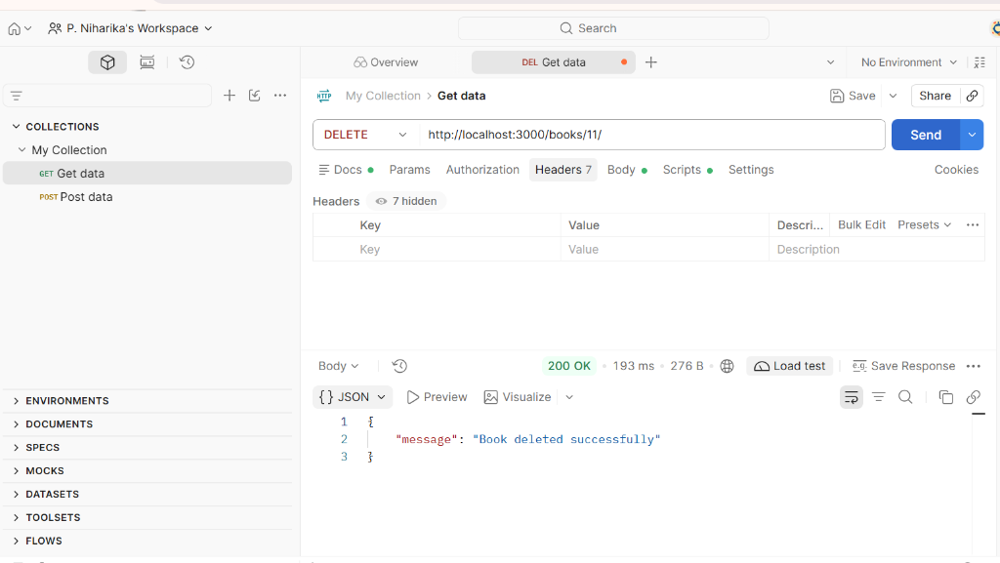 |
| `validation-error.png` | POST `/books/` with missing title returning 400 | 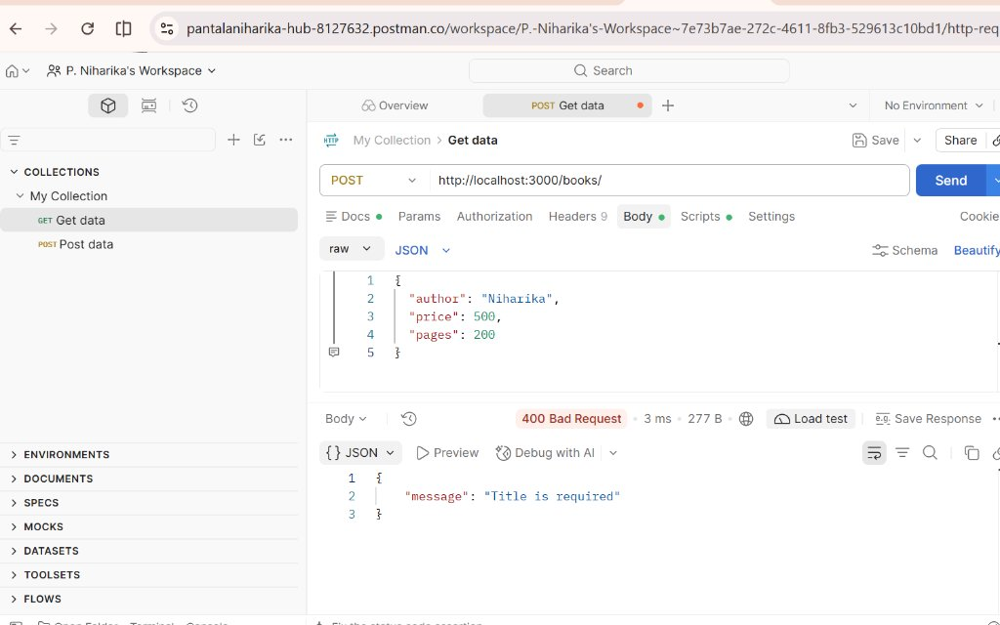 |
| `not-found.png` | GET `/books/99999/` returning 404 Book not found | 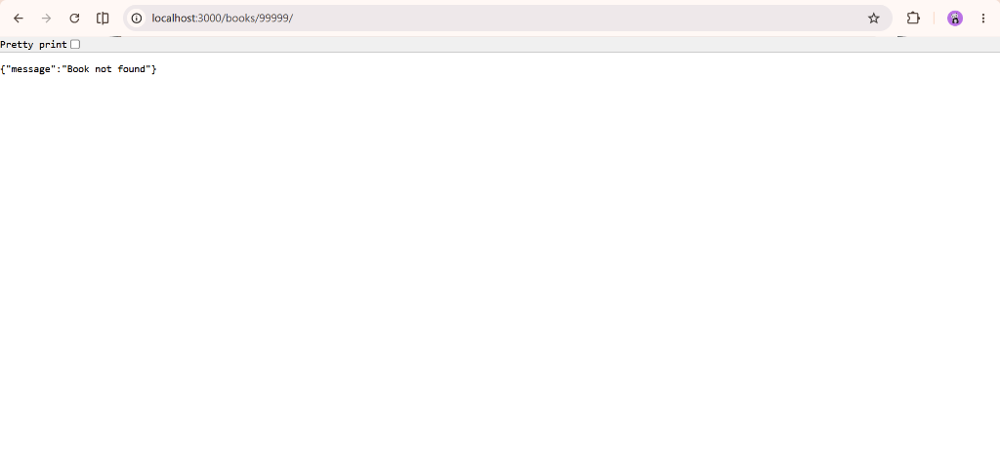 |
| `debugging.png` | Terminal showing automated 22 test suite passing 100% | 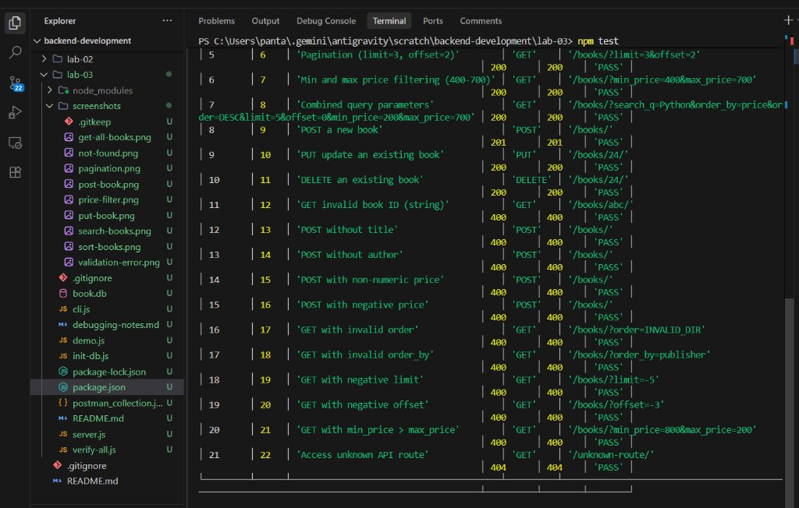 |

---

## 🐞 15. Debugging Notes Summary

Detailed error analysis, stack traces, and code comparisons are documented in [`debugging-notes.md`](./debugging-notes.md). A summary of the four key errors addressed:

1. **`EADDRINUSE` (Port Conflict):**
   - *Cause:* Previous server process still holding port `3000`.
   - *Fix:* Configured `process.env.PORT || 3000` and terminated running PID with `taskkill /PID <PID> /F` (Windows) or `npx kill-port 3000`.
2. **`MODULE_NOT_FOUND` (Wrong Import Path):**
   - *Cause:* Forgetting relative `./` prefixes or mismatched file casing on case-sensitive hosting systems.
   - *Fix:* Enforced standard CommonJS `require('./...')` patterns and validated `package.json` dependencies.
3. **`SQLITE_ERROR: no such table`:**
   - *Cause:* Using relative paths for `book.db` causing SQLite to create empty database files in `process.cwd()` instead of project root.
   - *Fix:* Anchored path with `path.join(__dirname, 'book.db')` and used `CREATE TABLE IF NOT EXISTS`.
4. **Missing `await` on Database Operations:**
   - *Cause:* Forgetting `await` on `db.all()` or `db.get()`, causing Express to serialize unresolved Promises into empty `{}` or evaluating truthy Promises incorrectly in `if (!book)` checks.
   - *Fix:* Added `await` to every asynchronous database call inside `async` route handlers.

---

## ⚠️ 16. Problems Faced and Solutions

1. **SQL Injection Vulnerability in Dynamic Query Strings:**
   - *Problem:* Directly interpolating user-provided `order_by` or `order` into SQL strings creates dangerous SQL injection vulnerabilities.
   - *Solution:* Implemented strict allowlists (`ALLOWED_ORDER_BY_COLUMNS` and `ALLOWED_ORDER_DIRECTIONS`). User inputs are validated against these arrays; if invalid, a `400 Bad Request` is returned immediately. All search and filter values are strictly parameterized using `?` placeholders.
2. **Empty JSON Responses Due to Asynchronous Promises:**
   - *Problem:* Omitting `await` on `db.get()` caused Express to send `{}` because pending JavaScript promises serialize to empty objects in `res.json()`.
   - *Solution:* Ensured all database access points use `await` with comprehensive `try/catch` blocks.
3. **Type Coercion Issues with Query String Numbers:**
   - *Problem:* Query parameters arrive as strings (e.g., `"10"`, `"-5"`). Standard checks like `typeof limit === 'number'` fail.
   - *Solution:* Parsed values using `Number()`, validated with `Number.isInteger()`, and enforced boundary conditions (`> 0` for limit, `>= 0` for offset).
4. **SQLite Persistence on Ephemeral Cloud Hosting:**
   - *Problem:* Free cloud hosting tiers (such as Render) employ ephemeral disks that wipe newly added database records upon server restart.
   - *Solution:* Bundled `book.db` with seeded records in the Git repository and built auto-seeding logic in `server.js` to ensure the table and records always exist on startup.

---

## 🎓 17. Learning Outcomes

1. Gained hands-on proficiency in designing RESTful APIs adhering to standard HTTP verbs (`GET`, `POST`, `PUT`, `DELETE`).
2. Implemented complex query parameter combinations: partial text search, dynamic multi-column sorting, two-point price filtering, and pagination.
3. Understood database security principles, parameterized queries, and input allowlisting against SQL injection.
4. Learned how to create predictable, uniform JSON API responses and map application errors to standard HTTP status codes (`200`, `201`, `400`, `404`, `500`).
5. Mastered diagnosing and fixing standard Node.js server exceptions (`EADDRINUSE`, module paths, SQLite table errors, async/await bugs).
6. Developed automated testing proficiency using Postman collections and assertion scripts.

---

## 🏁 18. Conclusion

Lab 3 successfully delivers an independently runnable, robust, and well-tested Express.js REST API with SQLite integration. All functional criteria—including partial title search, allowlisted sorting, price range filters, offset pagination, comprehensive input validation, and standard HTTP error handling—have been implemented and verified with a 100% test pass rate across all 22 test cases.

